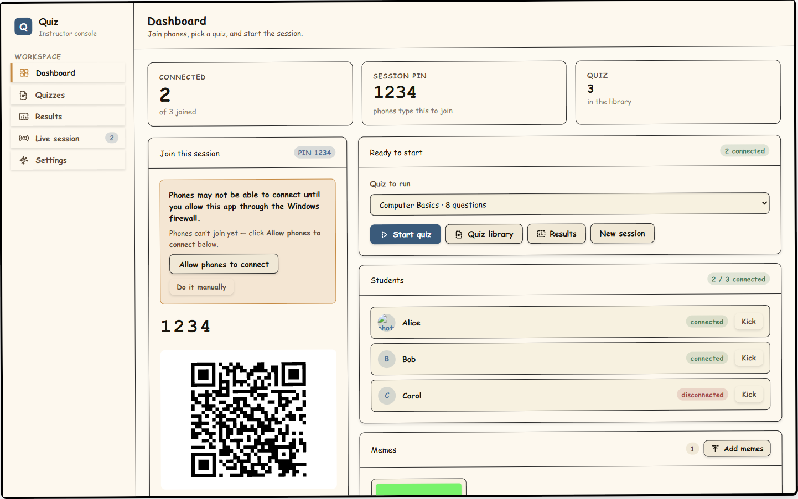
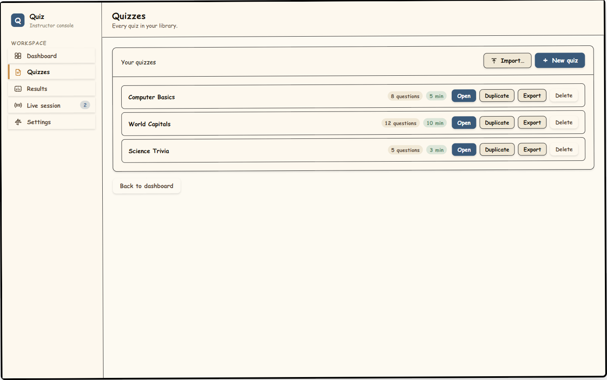
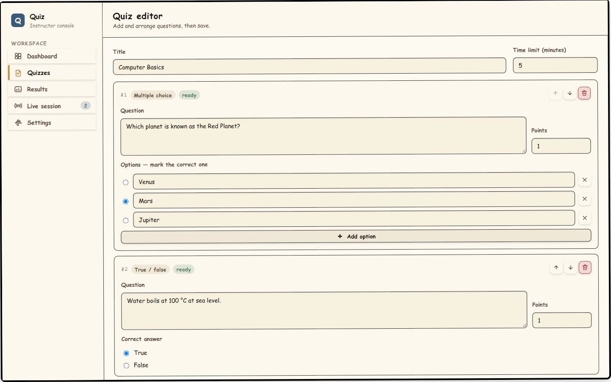
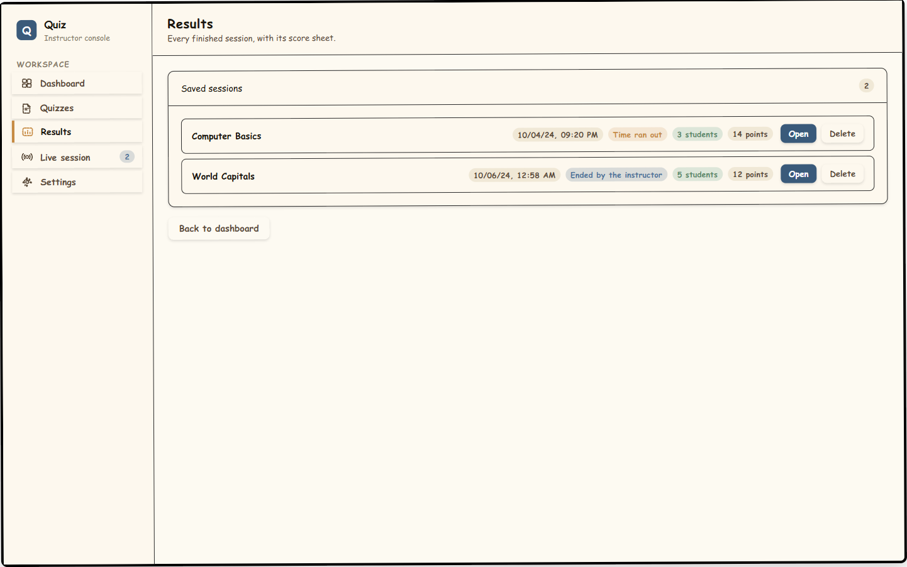
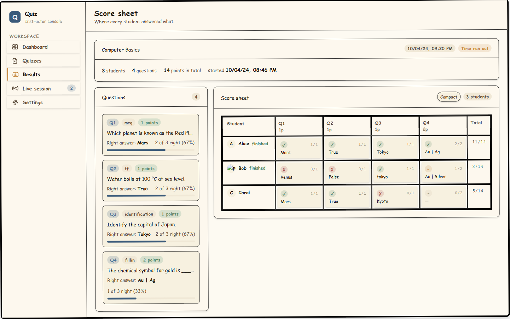
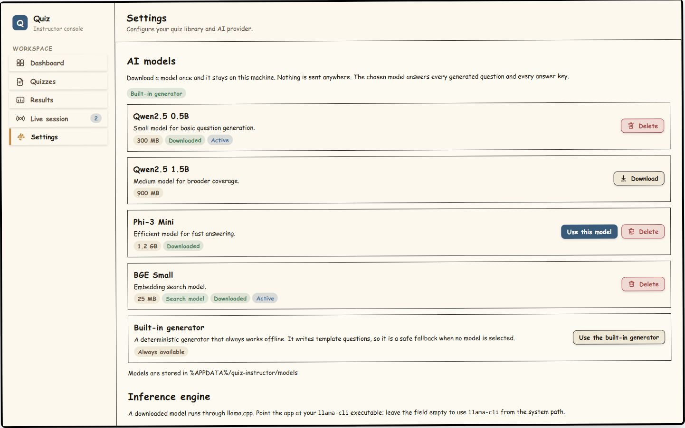

# Quiz Instructor

A Windows Electron app for running LAN quiz sessions. Scan the QR code from a phone, students join with a PIN, and you control the quiz from your PC. Answer keys never leave the instructor machine.

**Latest release: [v0.4.0](https://github.com/Chie0-dev/Quiz/releases/tag/v0.4.0)**

## Screenshots

| Dashboard | Quiz Library | Quiz Editor |
|---|---|---|
|  |  |  |

| Results | Score Sheet | Settings |
|---|---|---|
|  |  |  |

## Quick start

```bash
npm install
npm run dev        # development with hot reload
npm run build      # production build
npm start          # run the production build
npm run dist       # package a Windows .exe installer + portable
```

The app binds to port 8080–8089 (defined in `src/shared/types.ts`); the firewall rule always covers that full range.

## Requirements

- Windows 10/11
- Node.js 20+
- Instructor PC and phones on the same Wi-Fi (disable AP/client isolation)

## Joining from a phone

1. Start the app with `npm run dev`.
2. Scan the QR code or type the endpoint shown under it (e.g. `192.168.1.235:8080`), then enter the PIN.
3. Students appear in the **Students** list. Disconnect after 10 s of silence; reconnecting restores their identity.

## Importing a quiz

`Quizzes` → `Import…` reads `.docx`, `.pdf`, `.md`, or `.json` files. Unnumbered exam papers (no answer key) import as drafts — set the keys in the editor before starting. The import report lists what was read and any warnings.

## Windows firewall

The app checks the firewall on startup. If rules are missing, it shows an **Allow phones to connect** button that opens the UAC prompt:

| State | What you see |
|---|---|
| Ready | Green: *Firewall: ready, phones can connect* |
| Blocked | Amber notice with **Allow phones to connect** |
| Unknown | Grey notice, button still offered |

**Do it manually** if UAC is blocked by policy — it shows the two `netsh` commands to paste into an elevated PowerShell. Both commands are also in `setup-firewall.bat`, shipped next to the app.

The rules added are idempotent (no duplicates on repeat) and use `profile=any` so classroom Wi-Fi — often classified as Public — is covered.

## Offline AI

`Settings` manages downloaded GGUF models (Qwen2.5, Phi-3 Mini). They answer offline; nothing is sent over the network. A built-in generator always works as a fallback. Point the app at your `llama-cli` binary in Settings to use a downloaded model. The model files live in `%APPDATA%\quiz-instructor\models`.

**Model safety checks** (so a small model doesn't invent answers):
- Every answer is looked up in the source text.
- Each question targets a different sentence.
- Question types that don't apply to the text are skipped.
- You still review the questions before running the quiz.

## Results & scoring

Every finished session saves with its score sheet: a question list (right answer, how many got it) and a students × questions grid. The sheet pages width-wise — never scrolls sideways. Click any cell to adjust points, mark correct/wrong, or add a note. The answer editor is a drawer that slides up from the bottom, so it's always where you clicked.

Grading covers all 8 question types with partial credit for multi-part ones. Written answers ignore case, spacing, and dash variants, and the closest accepted answer is suggested when a student is off by a typo.

## Live session

While a quiz runs, the content area shows the countdown timer (urgent under 30 s, frozen when paused), question-by-question answer counts, and grouped student cards (connected / paused / finished / disconnected). A locked quiz pauses students on focus loss — they need your **Approve resume** button (or Approve all) to keep going.

## Memes

The meme tray (bottom of the Dashboard) pops images onto students' phones mid-quiz. Compressed in-renderer (max 1024 px, JPEG unless transparency is needed) and served from the same server port. The phone fetches the image itself; only a relative path travels over the socket. A meme never pauses the countdown.

## Testing

```bash
npm run check         # end-to-end protocol checks against a real server
npm run ui-check      # drives the real UI via CDP (needs --remote-debugging-port=9222)
npm run fake-student  # --pin 1234 --name Alice
```

`ui-check` attaches to a running app over the DevTools protocol, clicks by `data-testid`, and asserts state. A fake student client is included for testing without phones.

## What's new

| Version | Key change |
|---|---|
| **v0.4.0** | Settings screen for offline AI models; AI answer-key auto-select in the editor; first-run nudge when no model is installed. |
| **v0.3.4** | Dashboard firewall line always visible (not only when broken); Settings opens from the editor. |
| **v0.3.3** | Softened shadows, QuizLibrary warnings badge, `data-testid` on key UI elements for ui-check. |
| **v0.2.7** | Instructor logo on the app icon. Student cards wrap status badges instead of squeezing names. |
| **v0.2.6** | CSS duplicate-property guard; question numbers counted once in the main process. |
| **v0.2.5** | Answer editor as a bottom drawer (context-aware, Escape to close). |
| **v0.2.4** | Score sheet paged width-wise with a compact mode; student column and total stay fixed. |
| **v0.2.3** | Importer reads `.docx`, `.pdf`, `.md` — printed exams with no answer keys import as drafts. |
| **v0.2.2** | Answers matched ignoring case, spacing, and dashes; closest answer suggested. |
| **v0.2.1** | Firewall check at startup; dashboard always shows firewall state; `setup-firewall.bat` shipped. |
| **v0.2.0** | Results and score sheet; scoring for all 8 question types with partial credit. |
| **v0.1.0** | First portable build: quiz library, editor, live session with counts, meme tray. |

Builds:

- `QuizInstructor-<version>-setup.exe` — installer with a stable path (recommended).
- `QuizInstructor-<version>-portable.exe` — single-file, no install, unpacks to a temp folder each run.
